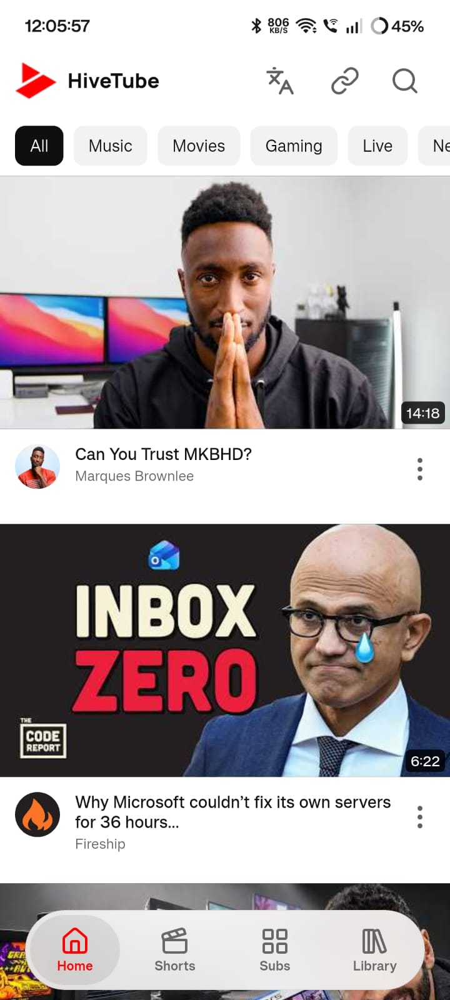
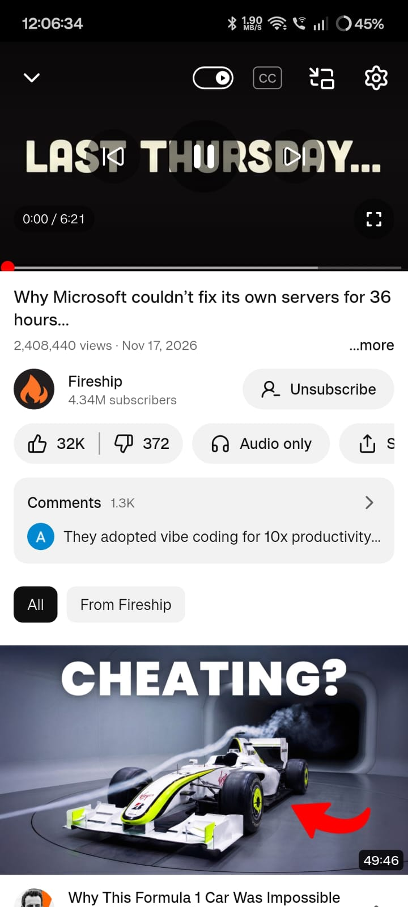
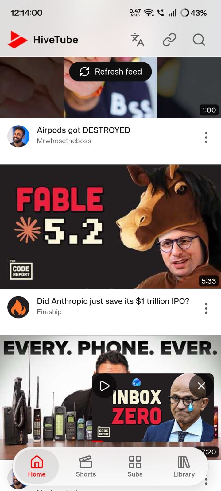
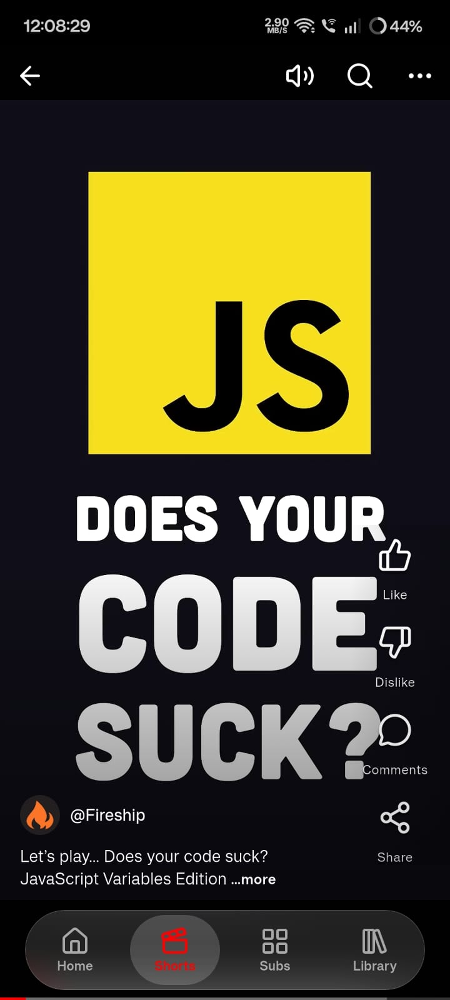
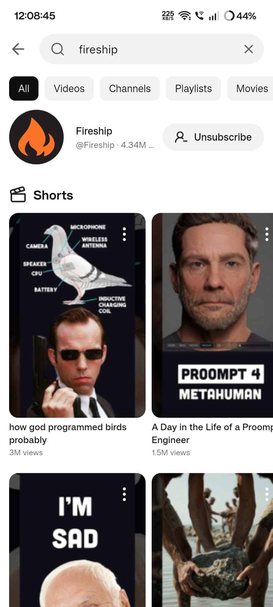
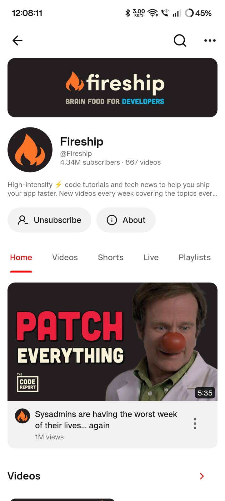
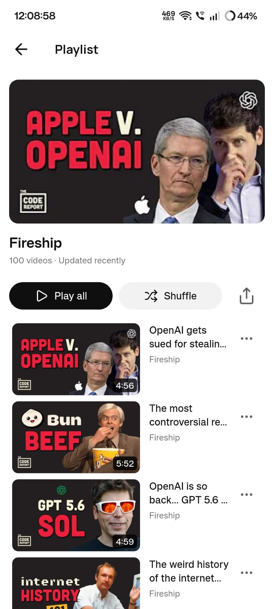
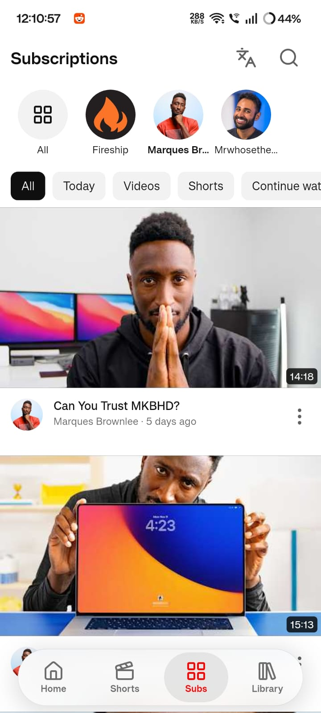
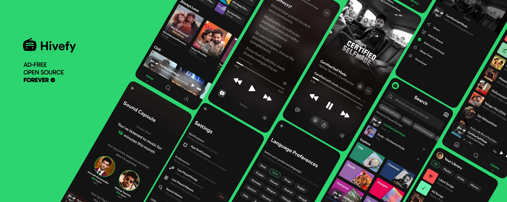

<div align="center">


# HiveTube

**Stream freely. Browse privately. Zero interruptions.**<br/>
A lightweight, privacy-focused YouTube and Shorts client for Android, featuring background playback, picture-in-picture, smart on-device multi-language content filtering, and offline downloads.

[](https://github.com/Harish-Srinivas-07/hivetube/releases/latest)
[](https://github.com/Harish-Srinivas-07/hivetube/releases)
[](#-download)
[](https://flutter.dev)

<a href="https://github.com/Harish-Srinivas-07/hivetube/releases/latest">
  
</a>

</div>

---

## 📸 Screenshots

<table align="center">
  <tr>
    <td align="center"><br/><sub><b>Home Feed</b></sub></td>
    <td align="center"><br/><sub><b>Watch Player</b></sub></td>
    <td align="center"><br/><sub><b>Mini Player</b></sub></td>
    <td align="center"><br/><sub><b>Shorts</b></sub></td>
  </tr>
  <tr>
    <td align="center"><br/><sub><b>Search</b></sub></td>
    <td align="center"><br/><sub><b>Channels</b></sub></td>
    <td align="center"><br/><sub><b>Playlists</b></sub></td>
    <td align="center"><br/><sub><b>Subscriptions</b></sub></td>
  </tr>
</table>

---

## ✨ Features

### 📺 Watch & Playback
- **Completely Ad-Free**: Enjoy uninterrupted videos and Shorts without commercial interruptions.
- **Native Picture-in-Picture (PiP)**: Full native Android Picture-in-Picture support with auto-enter on swipe/home navigation, adaptive aspect ratio, seamless resizing, and remote play/pause actions.
- **Audio-Only Playback**: One-tap toggle for dedicated audio-only streaming to save mobile data and battery while multitasking or listening on the go.
- **Background & Lock Screen Play**: Continuous playback with your screen locked or while switching apps, complete with media notification and lock screen controls via `audio_service`.
- **Floating Draggable Mini Player**: A fluid, floating player widget that moves freely across the screen as you explore other pages (swipe up to expand, swipe down or tap close to dismiss).
- **Video Quality Selector**: Choose video resolutions from 144p up to 4K 60fps, or leave it on Auto for adaptive stream quality.
- **Buffer Optimization & Fast Streaming**: Optimized stream loading, chunked requests, and buffer fixes for reliable, stall-free playback.
- **Open Any YouTube Link**: Paste any YouTube URL (`youtu.be`, `youtube.com/watch`, `/shorts`, or `/live`) directly into the search bar to stream instantly without opening a browser.

### 🎛️ Rich Player & Interactive Controls
- **Return YouTube Dislike**: Community dislike statistics seamlessly restored on video details.
- **Closed Captions (CC)**: Multi-language subtitle track selection with clear on-screen rendering.
- **Variable Playback Speed**: Precise playback speeds (0.25× to 2.0×) and quick press-and-hold for 2× speed.
- **Repeat Loop & Autoplay**: Loop your favorite videos indefinitely or toggle autoplay to automatically play recommended next videos.
- **Interactive Chapter Markers**: Visual chapter ticks on the scrub bar and a dedicated chapters bottom sheet for instant seeking.
- **Comments & Discussion**: Full interactive comments sheet with replies, author badges, and like counts.
- **Intuitive Gestures**: Double-tap to seek, pinch-to-zoom, and a built-in sleep timer.

### 🌐 Smart Language & Content Engine
- **Decentralized Feed Generation**: Your Home feed is synthesized directly on your device from public search, related topics, and channel feeds—never tracked by a central algorithm.
- **Multi-Tier Language Classifier**: Analyzes video metadata through script detection, romanized lexicon matching (Tanglish, Hinglish, etc.), channel history voting, and fast caption probing (`CaptionProbeService`).
- **Language Allowlist & Hidden Language Removal**: Curate feeds to your preferred languages, and actively remove/hide unwanted languages so they are completely dropped from recommendations.
- **Granular Local-to-Global Balance**: Adjustable slider to fine-tune the recommendation ratio between local content and global discovery.

### 📥 Offline Downloads & Device Export
- **Video & Audio Downloads**: Download videos up to 1080p with resolution selection, or extract audio-only tracks (M4A/MP3/WebM) for offline listening.
- **Save to Downloads & Gallery**: Export completed downloads directly to your device's public Downloads folder and Gallery/Photos to access, play, or share them in external apps.
- **In-App Downloads Library**: Play, pause, resume, and manage downloaded media directly in HiveTube with saved progress tracking.
- **Native Muxing**: Fast, lossless video and audio stream merging powered by native FFmpeg.

### 📚 Private Library, Playlists & Channels
- **Account-Free Subscriptions**: Follow channels without any Google login; updates are fetched directly via public RSS feeds.
- **Custom Local Playlists**: Create, manage, and reorder custom playlists stored offline on your device.
- **Channel Profiles**: Explore full channel pages with dedicated tabs for Videos, Shorts, Playlists, and About info.
- **Watch History & Progress**: On-device watch history with saved playback positions, pause history toggle, and one-tap history clearing.
- **Import & Backup**: Import subscriptions easily from **Google Takeout** `subscriptions.csv` archives or export/restore your data using HiveTube's JSON backups.
- **Local SQLite Persistence**: Subscriptions, watch history, custom playlists, and preferences stay strictly on your device via [Drift](https://drift.simonbinder.eu/).

### 🎨 Themes & Responsive Design
- **Theme Customization**: Switch seamlessly between **System Default**, **Light**, **Dark**, and battery-saving **OLED Pure Black** themes.
- **Adaptive Layout**: Responsive interface with a 600px navigation rail for tablets and a two-column watch screen layout at 1024px.
- **Material 3 Design Tokens**: Polished UI built on modern Material 3 design tokens for colors, typography, spacing, and motion.

---

## 🎵 Looking for a Music Player?

<a href="https://github.com/Harish-Srinivas-07/hivefy">
  
</a>

If you want a dedicated YouTube-based music streaming app with a Spotify-inspired UI, check out **[Hivefy](https://github.com/Harish-Srinivas-07/hivefy)**!

- Spotify-style dark user interface & playlist management
- Stream millions of tracks and albums directly from YouTube Music
- Background audio playback, lock screen controls, and synchronized lyrics

👉 **[Download Hivefy on GitHub](https://github.com/Harish-Srinivas-07/hivefy)**

---

## 📥 Download

Grab the latest APK from the **[Releases page](https://github.com/Harish-Srinivas-07/hivetube/releases/latest)** and install it.

| APK | Architecture / Device |
|---|---|
| `HiveTube_<version>_common.apk` | Modern 64-bit Android phones and tablets (`arm64-v8a`, recommended — smaller file size) |
| `HiveTube_<version>_universal.apk` | Universal package compatible with all supported Android architectures (`arm64-v8a`, `armeabi-v7a`, `x86_64`, emulators) |

> [!NOTE]
> HiveTube is distributed independently. You may need to grant permission to install unknown apps from your browser or file manager when installing for the first time.

---

## 🔒 Privacy

- **Zero Trackers & Telemetry**: No ads, no third-party analytics, and no fingerprinting.
- **On-Device Storage**: Your library, subscriptions, search history, and downloads stay strictly on your device.
- **No Account Required**: Full functionality without needing a Google account or authentication tokens.

---

## 🗺️ Roadmap & Upcoming Milestones

To keep expectations clear, here is the current status of features and differences from other clients:

| Feature | Status in HiveTube | Implementation Notes |
| :--- | :--- | :--- |
| **Picture-in-Picture (PiP)** | 🟢 *Fully Supported* | Native Android PiP with auto-enter on leave, adaptive video aspect ratio, seamless resizing, and remote notification / PiP play-pause actions. |
| **SponsorBlock Integration** | 🟡 *Planned / Upcoming* | Planned in `docs/features.md`. Segment skipping via privacy-friendly hash prefix API is on the roadmap. |
| **NewPipe Backup (.zip/.db) Import** | 🟡 *Planned* | Currently supports **Google Takeout** `subscriptions.csv` import and native JSON backups (`backup_service.dart`). Direct NewPipe DB archive parsing is planned. |
| **Storyboard / Seekbar Preview Scrubbing** | 🟡 *Planned* | Interactive chapter ticks and seeking are supported; visual thumbnail frame scrubbing is planned for a future update. |
| **Google Sign-In / Account Sync** | ❌ *Out of Scope (By Design)* | HiveTube is strictly 100% account-free and private; no Google sign-in or cloud sync will be added. |
| **Chromecast / DLNA Casting** | ❌ *Not Planned Currently* | Built around `media_kit` (mpv) for optimized on-device playback. |
| **Android TV / Remote D-Pad Navigation** | ❌ *Not Planned Currently* | Tailored for Android touch screens (phones and tablets with responsive side rail/watch layouts). |

---

## 🛠️ For Developers

HiveTube is built with Flutter and modern state management using Riverpod.

### Architecture Overview

```
lib/
├── app/          # App shell, navigation router, lifecycle management
├── core/         # Playback engine, stream handling, Drift SQLite DB, content filtering, update service
├── features/     # Feature screens: home, watch, shorts, search, channel, playlist, library, settings
├── theme/        # Material 3 tokens (colors, typography, spacing, layout, motion)
└── widgets/      # Shared components: VideoCard, AppChip, AppButton, AppSheet, Player controls
```

### Building from Source

```bash
# Clone the repository
git clone https://github.com/Harish-Srinivas-07/hivetube.git
cd hivetube

# Fetch dependencies
flutter pub get

# Generate Drift database models and Riverpod code
dart run build_runner build --delete-conflicting-outputs

# Run code analysis and design lints
dart analyze
dart run tool/design_lint.dart

# Run tests
flutter test --no-pub

# Launch the app
flutter run
```

---

## 🙏 Credits & Acknowledgments

HiveTube is built with gratitude towards the following projects and communities:

- [YouPipe](https://github.com/SanuSanal/YouPipe): Thank you for UI & feature inspiration.
- [NewPipe](https://github.com/TeamNewPipe/NewPipe): Thank you to the NewPipe team for their pioneering extractor source documentation and reverse-engineering research.
- [Flutter](https://flutter.dev): Cross-platform UI toolkit.
- [media_kit](https://github.com/media-kit/media-kit): High-performance video playback engine powered by `mpv`.
- [Drift](https://github.com/simolus3/drift): Reactive SQLite persistence for Dart & Flutter.
- [audio_service](https://github.com/ryanheise/audio_service): Background playback and lock screen controls.
- [Return YouTube Dislike](https://returnyoutubedislike.com): Accurate community dislike count statistics.
- [Lucide Icons](https://lucide.dev): Clean, consistent icon design system.

---

## ⚖️ Disclaimer

1. HiveTube is an unofficial client and is not affiliated with, endorsed by, or associated with YouTube, Google LLC, or any of their subsidiaries.
2. All trademarks, videos, and content displayed in the app belong to their respective copyright holders.
3. HiveTube is intended for personal and educational use.

<div align="center">
<br/>
<sub>Crafted with care 🤍 for a clean, private video experience.</sub>
</div>
